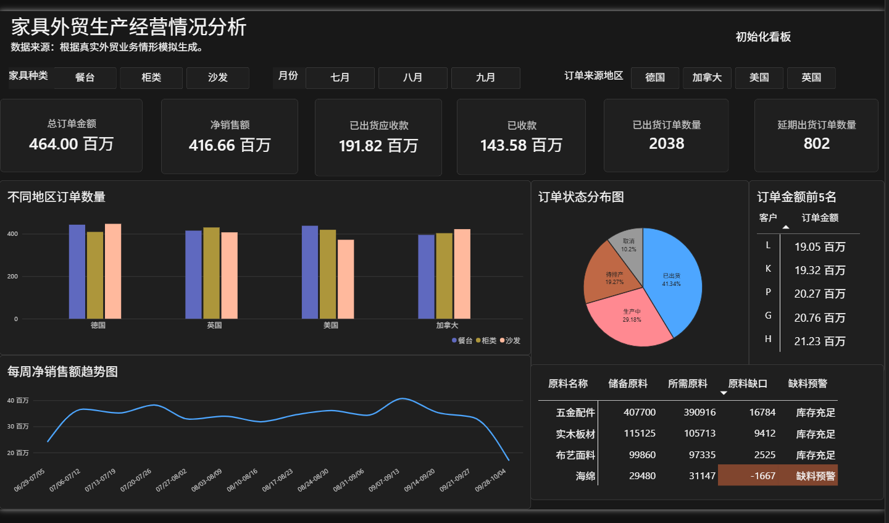

# Furniture foreign trade analysis.

## 一、项目背景
本项目根据家具行业的生产销售特点，模拟了一份业务数据，构建了一个生产经营监控看板，使管理者能够快速看清趋势并锁定异常。

## 二、看板预览

## 三、核心业务亮点
  1.**销售情况监控**：整合订单金额、应收、已收款项、出货交付数量和准时情况
  2.**缺料预警**：构建原料监控模型，监控生产原料储备与订单规模的匹配情况。
  3.**趋势分析**：按时间、地区维度洞察销售趋势与订单分布。

## 四、技术栈与应用
  1.**mysql**：整合数据。
  2.**pandas**：进行数据处理，输出csv文件。
  3.**power BI**：连接数据并实现可视化。
